<p align="center">
  <picture><source media="(prefers-color-scheme: dark)" srcset="docs/art/banner-dark.svg"></picture>
</p>

**A local mission control for AI coding agents.** One page on `localhost` shows what your agents are running, what they built, what they learned and what is waiting on you, with a Second Brain map of your whole workspace in the middle.

It works with Claude Code, Codex, GitHub Copilot CLI and the Claude API, runs on `127.0.0.1` only, and needs nothing but Node.

Plain Node.js server, no framework and no build step · vanilla HTML, CSS and JS · three.js and d3 bundled · MIT

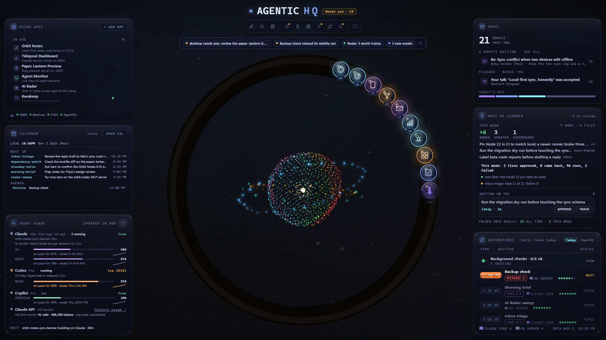


## <picture><source media="(prefers-color-scheme: dark)" srcset="docs/art/icon-demo-dark.svg"></picture> Try the demo

```bash
npm run demo
```

Then open http://localhost:50170.

The demo copies the kit into a temporary sandbox and fills it with a made-up team: projects, inbox, calendar, routines, lessons and a month of agent usage. The server runs in demo mode: the feeds answer from `demo/fixtures/`, every action is refused, and your own files, agent logs and accounts are never read. Every screenshot below comes from it.

## <picture><source media="(prefers-color-scheme: dark)" srcset="docs/art/icon-what-dark.svg"></picture> What it does

<p align="center">
  <picture><source media="(prefers-color-scheme: dark)" srcset="docs/art/flow-dark.svg"></picture>
</p>

### <picture><source media="(prefers-color-scheme: dark)" srcset="docs/art/icon-needs-dark.svg"></picture> Needs you

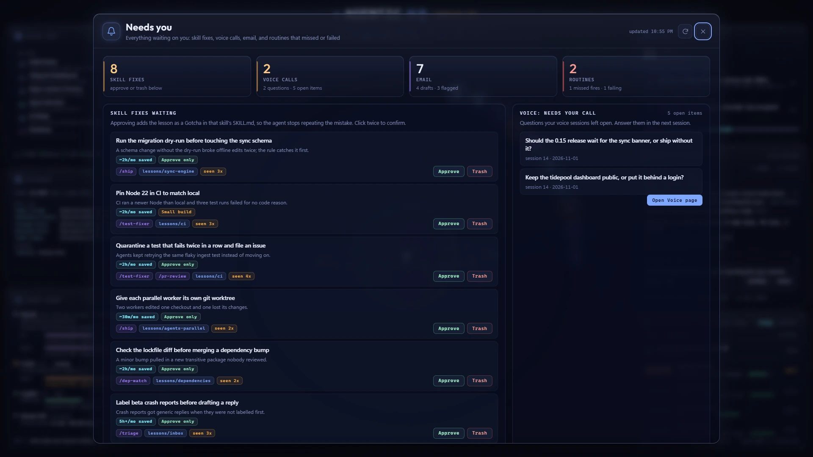

One queue for everything that waits on a person: lessons your agents want to add to a skill, questions left open in voice sessions, email drafts, and routines that missed a fire or failed. Approving a skill fix writes it into that skill's `SKILL.md` as a Gotcha, so the agent stops repeating the mistake.

### <picture><source media="(prefers-color-scheme: dark)" srcset="docs/art/icon-learned-dark.svg"></picture> What HQ learned

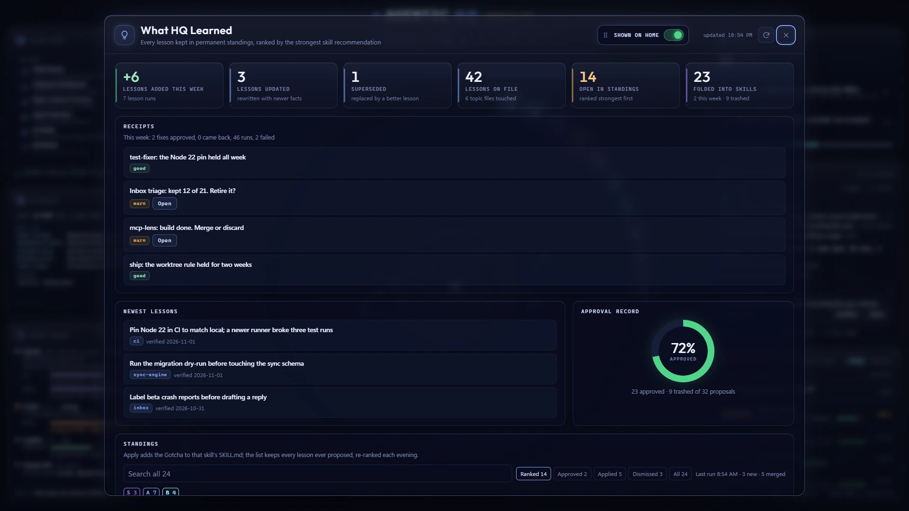

Lessons captured from agent runs are kept in permanent standings and re-ranked each evening. Receipts show whether last week's fixes held, and the approval record shows how many proposals you kept.

### <picture><source media="(prefers-color-scheme: dark)" srcset="docs/art/icon-deck-dark.svg"></picture> Skills deck

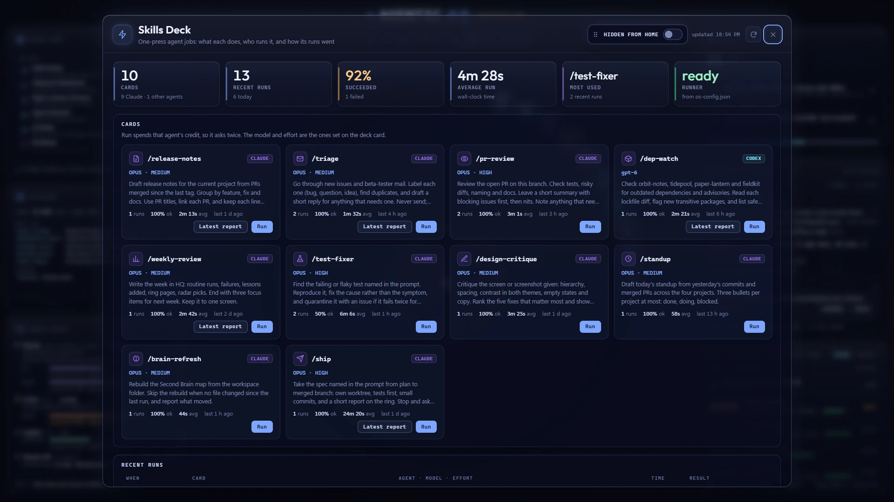

One card per skill. Each card picks its agent (Claude Code, Codex, Copilot or the Claude API), model and effort, and runs only when you click it. Runs log to `os-runs/` and come back as pages on the ring.

### <picture><source media="(prefers-color-scheme: dark)" srcset="docs/art/icon-routines-dark.svg"></picture> Routines and automations

| | |
|---|---|
| 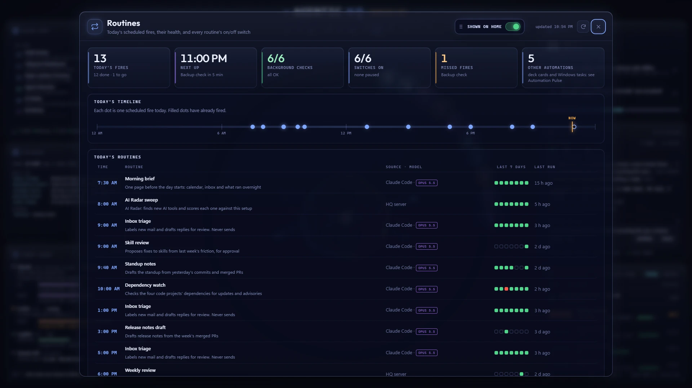 | 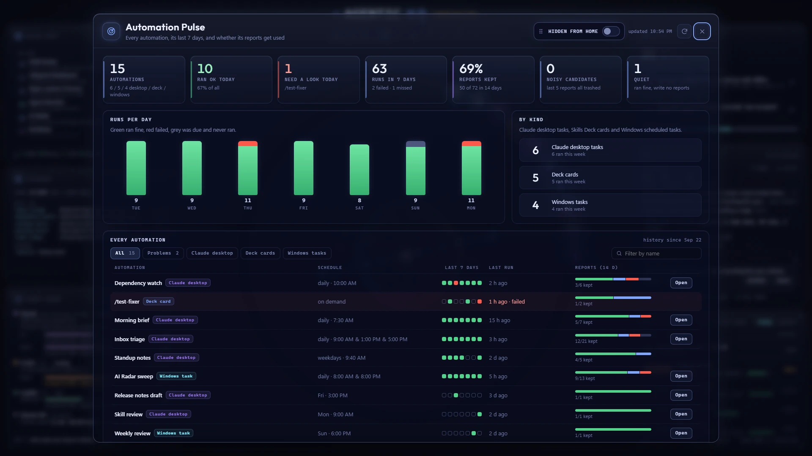 |

Every scheduled fire today, its last 7 days and its on/off switch, from Claude desktop scheduled tasks, Windows Task Scheduler and any schedule you import. A watchdog (`tools/hq-sentinel.mjs`, no model calls) keeps HQ and its companion tools up, warns on low disk space, memory and agent usage burn rate, and flags missed fires. Weekly Git bundle backups, with a monthly restore test, are checked by `tools/hq-doctor.mjs`.

### <picture><source media="(prefers-color-scheme: dark)" srcset="docs/art/icon-find-dark.svg"></picture> Find anything

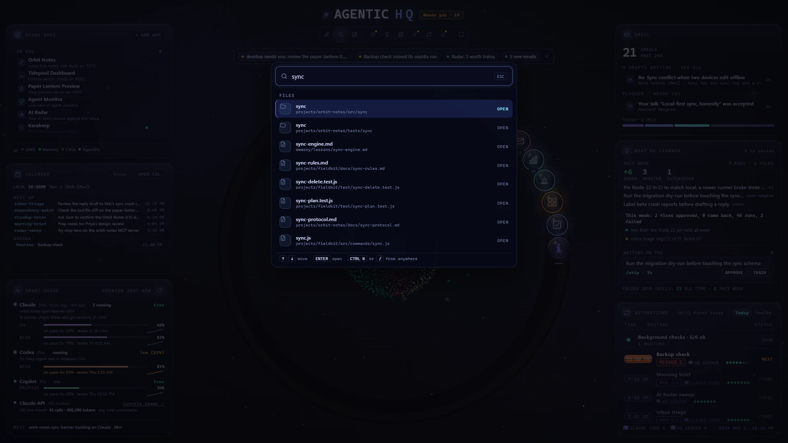

Press `Ctrl+K` or `/` anywhere. One box searches your apps, skills, routines, ring pages and every file in the Second Brain.

### <picture><source media="(prefers-color-scheme: dark)" srcset="docs/art/icon-ring-dark.svg"></picture> The artifact ring

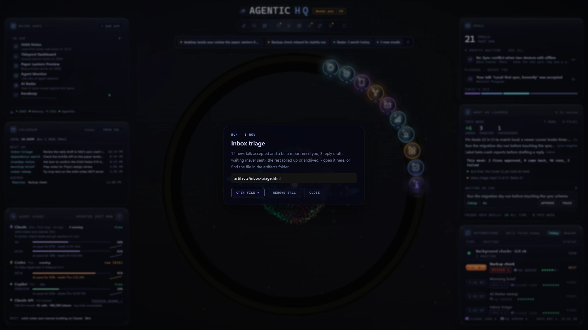

Every HTML page your agents build (reports, dashboards, run summaries) becomes a ball on the ring. Pages open in a sandboxed frame that cannot call HQ's API. A review bar lets you leave comments and have an agent apply them.

### <picture><source media="(prefers-color-scheme: dark)" srcset="docs/art/icon-brain-dark.svg"></picture> Second Brain

| | |
|---|---|
| 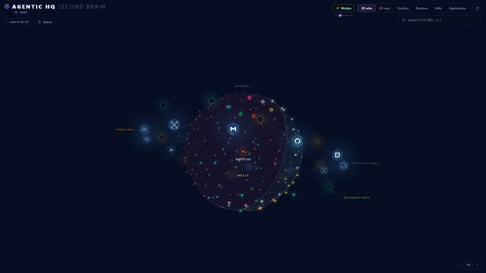 | 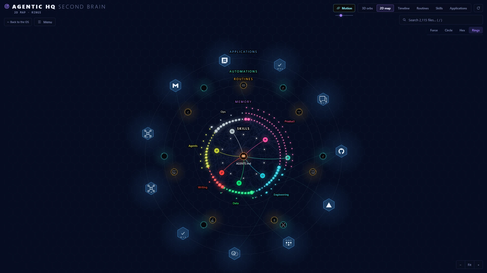 |
| **3D orbs:** your workspace as coloured departments | **2D map:** Force, Circle, Hex and Rings layouts |
| 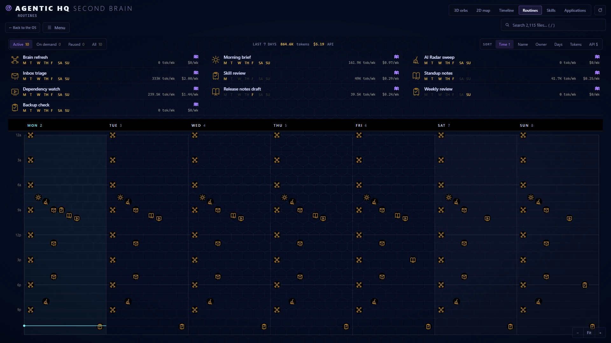 | 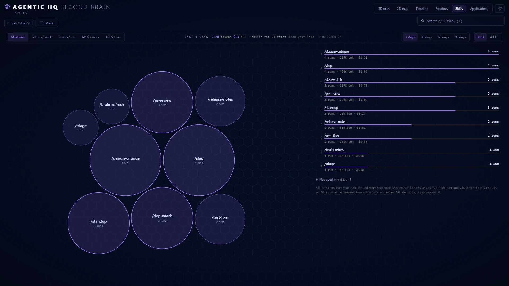 |
| **Routines:** measured runs and tokens per week | **Skills:** runs and tokens per skill, 7 to 90 days |
| 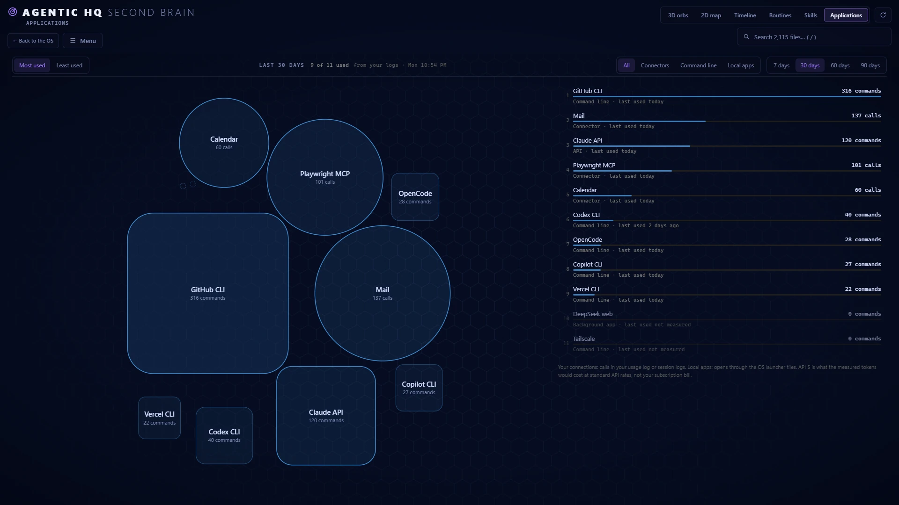 | 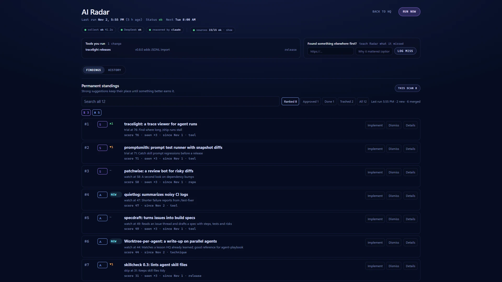 |
| **Applications:** connectors, CLIs and APIs by use | **AI Radar** (`/radar`): new tools ranked for your setup |

The Second Brain maps your workspace (file names, sizes and dates, plus the links inside markdown files) and sizes everything by how much your agents actually use it. There is also a Timeline view. Usage comes from Claude Code's session logs when you allow it, or from a one-line usage log any agent can write ([USAGE.md](USAGE.md)). Anything nothing measures says "not measured".

**AI Radar** collects public sources (Hacker News, GitHub releases, RSS feeds) twice a day, scores what is new against your own setup, and keeps permanent standings. Implement builds a candidate on its own branch in a separate worktree; Merge runs the tests first and only merges that exact commit.

### <picture><source media="(prefers-color-scheme: dark)" srcset="docs/art/icon-widgets-dark.svg"></picture> More widgets

| | |
|---|---|
| 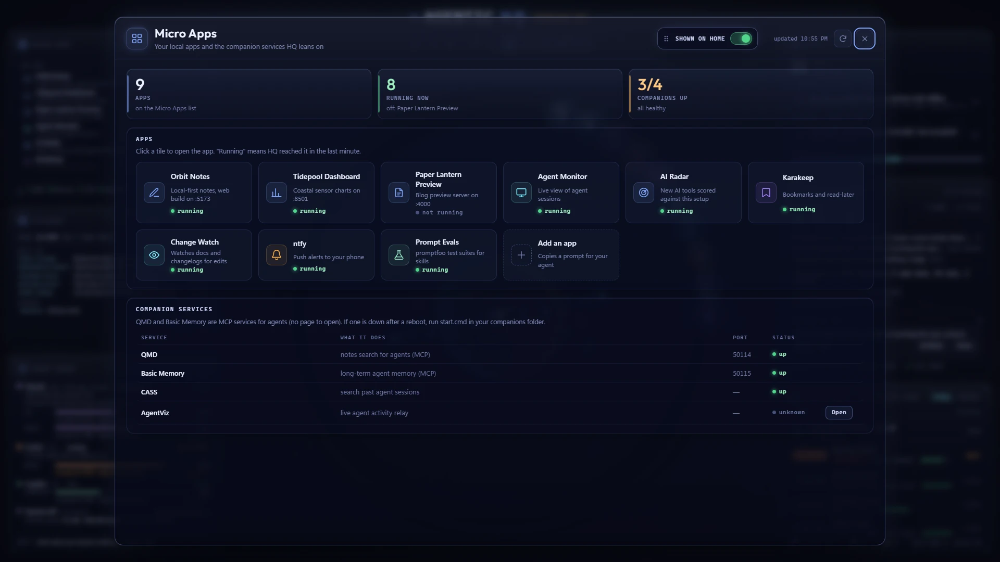 | 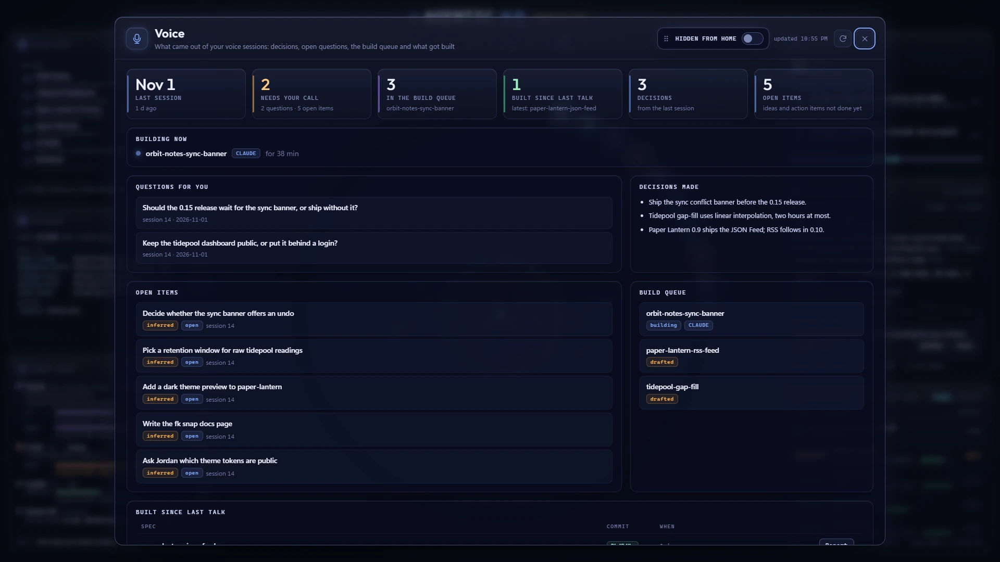 |
| **Micro Apps:** your own local apps, one click away, with live status | **Voice:** decisions, open questions and the build queue from your voice-session notes |

The homepage also has Calendar (Google, read-only), Email (Gmail counts, drafts waiting and flagged mail, read-only), and Agent Usage: Claude, Codex and Copilot meters with pace and reset times. Each widget can move to a dock page, and widgets you have not connected yet show a quiet "not wired yet" note.


## <picture><source media="(prefers-color-scheme: dark)" srcset="docs/art/icon-run-dark.svg"></picture> Run it on your own workspace

1. Install [Node.js](https://nodejs.org) 22 or newer.
2. Clone or download this repo.
3. Run `node server.js` in the folder. That one command starts everything, the Second Brain engine included.
4. Open http://localhost:50000. A short tour runs on your first visit.

The server has no dependencies. Run `npm install` only if you want the Gmail and Google Calendar tools (`tools/gmail.js`, `tools/google-calendar.js`). Run `node tools/hq-doctor.mjs` any time for a read-only health check.

### Let your agent set it up

The kit is built to be installed by your agent. Tell it:

> Read the README of this kit. Use what you already know about me and my workspace, then ask me only what you still need: which agent and schedulers I use, and which email and calendar I care about. Recommend which parts to wire first, then set it up step by step using the guides.

#### For the agent: the install steps

You are setting this up for your user, inside their workspace. Respect what you find: map it, never reorganise it. Do these in order.

1. **Check Node.** `node --version` must be 22 or newer. If not, tell your user how to install it and stop.
2. **Check the ports.** HQ uses port 50000 and the Second Brain engine 50201 by default. If something already answers on either, leave it alone and set `"port"` or `"brainPort"` in `os-config.json` to a free port.
3. **Point the OS at the workspace.** Fill `config/workspace.json`: `root`, `routerDoc`, `instructionDocs`, `skillDirs`, `memoryDir`, `projectsDir`, `visibleRoots` and `sharedPrefixes`. [BRAIN.md](BRAIN.md) step 1 explains each field.
4. **Write the departments.** These are the coloured slices of the 3D globe. Write 3 to 6 in `config/departments.json` from what you know about your user. [BRAIN.md](BRAIN.md) step 2.
5. **List the applications.** Real connections only (MCP servers, command-line tools that talk to a service, APIs with stored keys) in `config/apps.json`. [BRAIN.md](BRAIN.md) step 3.
6. **Agent readers.** `"readers": { "claudeCode": "auto" }` in `os-config.json` reads Claude Code's scheduled tasks and session logs when they are found ([ROUTINES.md](ROUTINES.md) and [USAGE.md](USAGE.md) list the folders). Set it to `false` if your user isn't on Claude Code or doesn't want them read.
7. **Routines.** Claude desktop tasks are read from its scheduler. Import other schedules through `snapshots/routines.json`. [ROUTINES.md](ROUTINES.md).
8. **Usage.** Without Claude Code's logs, add the one-line usage log habit from [USAGE.md](USAGE.md) to your instructions. The snippets in the guides have a `<path-to-your-os>` slot: put the absolute path of this folder there.
9. **Build the Second Brain, then start.** Run `node refresh/run.mjs`, then `node server.js`, open the page and check it: zero console errors, the orb opens the Second Brain, and the tabs show their files.
10. **Offer the rest, one at a time:** the skills deck runners ([WIRING.md](WIRING.md)), the calendar ([OAUTH.md](OAUTH.md)), email ([WIRING.md](WIRING.md)), the artifact ring habit ([RING.md](RING.md)), and an autostart that fits the machine.
11. **Offer the `/agenticos` skill.** Ask your user first. If they say yes, copy `skills/agenticos/` into your skills folder. It teaches you how to change, refresh, check and fix this OS later.

### Optional settings

| Setting in `os-config.json` | What it does |
|---|---|
| `runners` | The command for each agent a deck card can pick: `claude`, `codex`, `copilot`, `claude-api` |
| `places` | Folders outside HQ: the companion tools, the agent handoff workbench, the Orca worktree |
| `backup` | Where `tools/repo-backup.ps1` writes Git bundles; `tools/hq-doctor.mjs` checks them |
| `windowsRoutines` | Extra Windows Task Scheduler routines; `tools/install-hq-routines.ps1` installs them with the built-in watchdog and backup tasks |
| `ingest` | `extraRepos` and `privateWords` for the commit and session readers in `tools/ingest/` |
| `email`, `clocks`, `microApps` | The Email widget, the calendar's world clocks and your app tiles |

The routine installer and backup helpers use PowerShell and Task Scheduler, so they are Windows-only. The server and the Second Brain are plain Node.

## <picture><source media="(prefers-color-scheme: dark)" srcset="docs/art/icon-guides-dark.svg"></picture> The guides

| Part | Guide | What it covers |
|---|---|---|
| Second Brain | [BRAIN.md](BRAIN.md) | Departments, apps, skills, search and the file viewer |
| Routines | [ROUTINES.md](ROUTINES.md) | Everything on a schedule, for the widget and the Routines tab |
| Usage | [USAGE.md](USAGE.md) | Skill runs, routine runs and app use, or "not measured" |
| Skills deck, Email, Stats, Micro Apps | [WIRING.md](WIRING.md) | The runners, your inbox, any numbers, your own local apps |
| Calendar | [OAUTH.md](OAUTH.md) | One-time Google sign-in, then live events |
| Artifact ring | [RING.md](RING.md) | Teaching your agent to put every build on the ring |
| Look and feel | [REDESIGN.md](REDESIGN.md) | Reskinning the whole OS from one token block |

## <picture><source media="(prefers-color-scheme: dark)" srcset="docs/art/icon-folders-dark.svg"></picture> Folder map

```
agentic-hq/
  server.js         the HQ server (no dependencies); starts the Second Brain engine too
  os-config.json    ports, runners, skills deck, Micro Apps, email
  index.html        the shell: homepage + Second Brain
  os.html           the homepage
  radar.html        AI Radar (/radar)
  assets/           fonts, the orb, the dock pages, shared scripts
  brain/            the Second Brain's 3D orbs, 2D map and Timeline
  views/            the Routines, Skills and Applications tabs
  engine/           the Second Brain engine: the map scan, search and the file viewer
  refresh/          builds the Second Brain's data; sources/ holds per-agent readers
  lib/              server modules (radar, lessons, voice notes, attention, demo mode)
  config/           workspace.json, departments.json, apps.json, agents.json (yours to edit)
  snapshots/        calendar cache, optional routines.json and usage-log.jsonl (.example files are templates)
  demo/             the demo's fixtures, workspace generator and mock usage
  tools/            the watchdog, doctor, backups, routine installer, Gmail and Calendar tools
  skills/agenticos/ the /agenticos skill for your agent
  test/, tests/     node --test suites
```

HQ writes to `data/`, `os-runs/`, `artifacts/` and the generated Second Brain files. Ring pages in `artifacts/` are served sandboxed.

## <picture><source media="(prefers-color-scheme: dark)" srcset="docs/art/icon-security-dark.svg"></picture> Security model

- Both servers (HQ and the Second Brain engine) listen on `127.0.0.1` only, so nothing on your network can reach them.
- Both refuse any request whose Host header is not `localhost` or `127.0.0.1`, which stops DNS-rebinding pages.
- Every action (POST) must come from a page on this computer: Origin `localhost` or `127.0.0.1`, or no Origin at all (a command-line tool). Anything else gets 403, including Origin `null`, which a file page or a sandboxed frame sends.
- JSON actions also need `Content-Type: application/json`, which another website cannot send without a preflight, and no preflight is ever granted. Request bodies over 1 MB are refused.
- Ring pages are served with a `sandbox` Content Security Policy without `allow-same-origin`, so a page an agent wrote cannot call HQ's API or read its storage. Its review bar goes through a confirm popup that checks a nonce.
- Optional shared secret: start HQ with `HQ_TOKEN` set and every `/api/*` and `/local/*` request then needs a matching `x-hq-token` header. The older names `RUBRIC_TOKEN` and `x-rubric-token` still work. HQ prints at startup whether the secret is on, never its value. The bundled watchdog (`tools/hq-sentinel.mjs`) and doctor (`tools/hq-doctor.mjs`) do not send the header yet, so they stop working while the secret is on.
- Only the page files are served: the shell and homepage, `radar.html`, `widgets.html`, `assets/`, `brain/` and `views/`. `config/`, `snapshots/`, `engine/`, `refresh/`, `os-runs/`, `os-config.json` and the rest of `data/` (two page data files aside) are never served, and every path must resolve inside its folder.
- The file viewer reads text files inside your workspace root only, under 500 KB, and never a file whose name looks like a secret (`.env`, keys, tokens, credentials).
- Deck cards run when you click them, or when a routine you installed starts one, through the command template you set per runner. Prompts go on standard input, or as a short command-line argument limited to letters, numbers, spaces and `_ . / \ : , ( ) -`. Model and effort must come from the allowed lists.
- `/api/open` opens web links, or files inside your workspace, this folder or the ring. It never opens program files and uses no shell.
- Outside calls happen only in the parts you switch on: the calendar and email tools (Google), AI Radar (public feeds, then one reasoning call through your agent's command-line tool), the `claude-api` runner (with your own key), and whatever agent a runner starts. Two calls come from the server itself: with `ANTHROPIC_ADMIN_KEY` set, the usage meters read Anthropic's organization cost report (a read-only request, repeated every few minutes while HQ runs; see [WIRING.md](WIRING.md)), and with `ANTHROPIC_API_KEY` set, a context request that asks for an AI summary (`node tools/hq-context.mjs --ai`) makes one Claude API call.
- What it reads: your workspace (names, sizes, dates and markdown links), `config/` and `snapshots/`, and, if `"readers.claudeCode"` is on, Claude Code's scheduled tasks and session logs (to count runs, tokens and tool calls; only command names and local port numbers are kept, never full commands or message text). It stores no credentials of its own.

## <picture><source media="(prefers-color-scheme: dark)" srcset="docs/art/icon-tests-dark.svg"></picture> Tests

```bash
npm test
```

Runs the `node --test` suites in `test/` and `tests/`. It needs Node 22 or newer: `node --test` expands the file patterns itself only from Node 21, and the Windows shell does not expand them.

## <picture><source media="(prefers-color-scheme: dark)" srcset="docs/art/icon-license-dark.svg"></picture> License

MIT. Agentic HQ grew out of the RUBRIC Agentic OS starter kit by Jay E of [RoboNuggets](https://robonuggets.com), which is also MIT-licensed. Its original copyright and permission notice stay in [LICENSE](LICENSE), as the license requires. Bundled third-party files (three.js, d3, marked, thinking-orbs and two fonts) keep their own licenses, listed in [THIRD_PARTY_NOTICES.md](THIRD_PARTY_NOTICES.md).
